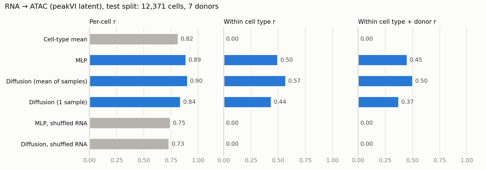

# rna2atac-diffusion

Predicting a cell's chromatin accessibility (snATAC-seq) from its gene expression (snRNA-seq)
in Alzheimer's disease brain tissue, with a conditional diffusion model, and checking how much
of that prediction goes beyond simply knowing the cell type.

## Results



Test split: 7 held-out donors (4 AD, 3 non-AD), 12,371 cells. Scores are Pearson correlations
in the 30-dimensional peakVI latent space of each cell's ATAC profile.

| Model | Per-cell r | Within cell type r | Within cell type + donor r | R² |
|---|---|---|---|---|
| Cell-type mean | 0.82 | 0.00 | 0.00 | 0.62 |
| MLP | 0.89 | 0.50 | 0.45 | 0.76 |
| Diffusion (mean of 10 samples) | 0.90 | 0.57 | 0.50 | 0.79 |
| Diffusion (1 sample) | 0.84 | 0.44 | 0.37 | 0.61 |
| MLP, shuffled RNA | 0.75 | 0.00 | 0.00 | 0.44 |
| Diffusion, shuffled RNA | 0.73 | 0.00 | 0.00 | 0.39 |

- **Cell identity explains most of the signal.** Predicting each cell type's average profile
  already reaches a per-cell r of 0.82.
- **Both models capture cell state beyond cell type.** The *within cell type* columns center
  each cell type (and, in the last column, each cell type within each donor) on its own mean,
  so the cell-type-mean baseline scores 0 by construction. About 0.5 of within-type correlation
  remains even within a single donor.
- **The conditioning is what carries that signal.** Shuffling the RNA embeddings among cells of
  the same type drops the within-type scores to 0.
- **Diffusion is modestly ahead of the MLP** (0.57 vs. 0.50 within cell type), but only when
  scored on the mean of its samples. A single sample does worse than the MLP. The MLP is a small
  baseline trained full-batch, so treat this gap as tentative.
- **Neither model generalizes to an unseen cell type.** On held-out OPCs, within-type r is about
  0.24 for both models but falls to 0.03–0.04 within a donor, so it reflects donor and region
  differences rather than cell state. R² is negative for every model
  ([full table](#held-out-cell-type-opc)).

## Approach

- **Conditioning:** [scVI](https://docs.scvi-tools.org/) embeds each cell's snRNA-seq profile
  into a 30-d cell-state latent.
- **Target:** [peakVI](https://docs.scvi-tools.org/) embeds the cell's snATAC-seq profile into a
  30-d continuous latent. The peakVI decoder maps generated latents back to per-peak
  accessibility.
- **Model:** a conditional DDPM (Gaussian noise, cosine schedule, 100 steps, MLP denoiser) that
  generates the ATAC latent given the RNA latent.
- **Baselines:** the cell-type mean of the training targets, and a 2-layer MLP from the RNA
  latent to the ATAC latent.
- **Control:** the same trained models, with each cell's RNA embedding swapped for that of a
  random cell of the same type.

## Data

Paired single-nucleus multiome (snRNA-seq + snATAC-seq) from post-mortem brain tissue of ROSMAP
participants, covering several brain regions and both AD and non-AD donors. The current results
use a 49,835-cell subset: 34 donors (18 AD, 16 non-AD), 5 regions, 7 major cell classes. The data
are not redistributed in this repository.

Preprocessing (`cli filter-peaks`, `cli pseudobulk`):

1. Filter a 1.2M-cell reference ATAC atlas to the 90,122 peaks that are accessible in at least
   5% of the cells of at least one of 67 cell subtypes.
2. Smooth each multiome cell's ATAC profile by summing it with its 25 nearest neighbors in
   harmonized LSI space, drawn only from the **same cell type and the same donor**. The multiome
   cells are themselves part of the reference atlas, so neighbors from other donors would leak
   ATAC signal between the train and test donors.

## Evaluation design

- **Donor split:** every cell (and every brain region) of a donor lands in exactly one of train
  (24 donors), val (3) or test (7). Donors are interleaved by AD status, so val and test stay
  balanced. A random cell split would let the model learn donor-specific structure and inflate
  test scores.
- **Held-out cell type:** all OPCs are excluded from training and scored separately.
- **Metrics:** per-cell Pearson r across latent dimensions; within-cell-type r (each latent
  dimension correlated across cells of one type, after centering that type); the same within
  each (cell type, donor) group; R². Diffusion point metrics use the mean of 10 samples.

### Held-out cell type (OPC)

4,569 OPCs from 34 donors, never seen in training. The cell-type-mean baseline falls back to
the global training mean.

| Model | Per-cell r | Within cell type r | Within cell type + donor r | R² |
|---|---|---|---|---|
| Cell-type mean | 0.44 | 0.00 | 0.00 | -2.26 |
| MLP | 0.76 | 0.23 | 0.04 | -0.73 |
| Diffusion (mean of 10 samples) | 0.76 | 0.24 | 0.03 | -1.02 |
| Diffusion (1 sample) | 0.67 | 0.15 | 0.01 | -2.41 |
| MLP, shuffled RNA | 0.71 | 0.01 | 0.00 | -1.03 |
| Diffusion, shuffled RNA | 0.71 | 0.01 | 0.00 | -1.48 |

## Limitations

- All metrics are computed in peakVI latent space, not per peak.
- One donor split, one seed: no error bars.
- The MLP baseline is small and may be undertrained. Stronger baselines (kNN in RNA space,
  ridge regression, published methods such as scButterfly) are not included.
- Results come from a 50k-cell subset of the cohort.

## Reproduce

Paths to data, checkpoints and figures are cluster-specific and are set in `.env`
(see `.env.example`); all other parameters are in `conf/default.config.yaml`.

```bash
uv sync
uv run cli filter-peaks                 # reference atlas -> prevalent peaks
uv run cli pseudobulk                   # same-donor kNN smoothing of the paired ATAC
uv run cli train                        # scVI, peakVI, baselines, diffusion
uv run cli eval --split test            # metrics + predictions_test.npz
uv run cli eval --split held_out
uv run cli results --split test         # results figure + markdown table from saved predictions
uv run pytest                           # unit tests, incl. no donor overlap between splits
```

`train` stops before training if any split has a `batch_key` category that the training split
lacks, since scVI and peakVI can't encode unseen batches.

## Related work

- **scButterfly, JAMIE:** dual-VAE cross-modal translation trained with regression objectives,
  which predict a single point estimate per cell.
- **ATAC-Diff (Huang et al., 2024):** latent diffusion for ATAC generation, not conditioned on
  RNA.
- **scDiffusion-X (2026):** multi-omics diffusion with cross-attention for cross-modal
  translation.

A conditional diffusion model can, in principle, represent a one-to-many RNA→ATAC mapping
instead of a single average. The results above only test its point predictions (the sample
mean); whether its sample diversity is calibrated is not yet evaluated.
